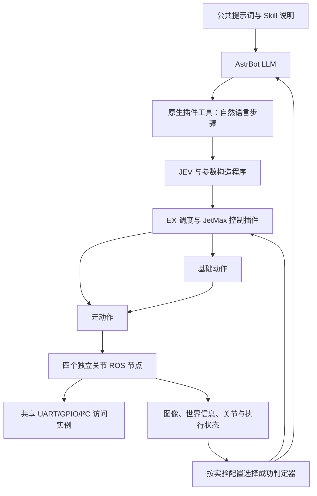

# JetMax 真机控制实现方案

更新：2026-11-01。状态：四关节 ROS 节点已通过 Jazzy／Humble 离线测试，并在 Nano 独立验收目录完成局部范围的运动、停止等待、取消、主动超时及夹爪开合检查；基础动作、EX/JEV 接线与对照实验仍待实施。

## 1. 交付范围与动作层次

本目录保存两份文档：

- `控制实现方案.md`：架构、接口、执行流程、成功判定和对照实验。
- [JEV自然语言指令规范.md](JEV自然语言指令规范.md)：供 AstrBot 原生插件加载的公共提示词，统一说明 LLM 怎样向 JEV 下达自然语言指令。

本方案之外已实现两个独立的关节 ROS 包，并完成[最小实机验收](acceptance/20261101-SvhtPO/RESULT.md)。EX 工具尚未注册，验收部署没有替换原控制安装。后续开发以现有 AstrBot、A.E.B. 和 EX 为基础，不建立第二套执行框架。

项目面向现有 Ubuntu 22.04、ROS 2 Humble 的 JetMax 真机。复用 EX 的动作契约、Goal、调度、资源管理和执行记录，保持与仿真一致的控制抽象，底层接入真实硬件与观测。本阶段不引入 CBF。

### 1.1 三层动作

| 层次 | 定义 | 示例 | 执行入口 |
|---|---|---|---|
| 元动作 | 明确控制某个关节或执行器 | 大臂抬起、小臂移动、底座转动、夹爪闭合 | 有 |
| 基础动作 | 内部具有控制流程或感知闭环的具名动作 | 寻找、接近校准、抓取、放置 | 有 |
| 高级技能 | 给 LLM 的抽象任务描述与组合参考 | 找到杯子并取回、整理物体 | 无独立执行入口 |

高级技能说明哪些动作组合可以完成某类任务。LLM 可以调整组合，不要求按示例固定执行，也不把高级技能名称直接当成 ROS 命令。

基础动作的边界如下：

- **寻找**：在允许的搜索范围内寻找指定目标，返回可继续使用的目标引用及观测。
- **接近校准**：识别并对齐选定目标，将夹爪移动到适合抓取的位置。这里的“校准”表示接近和视觉对齐，不表示修改机械零位或相机标定文件。
- **抓取**：仅包含闭合夹爪和抬起目标，不包含寻找、接近或对齐。
- **放置**：将已持有目标放到指定位置并释放。

抓取成功要求物体被持有并抬离支撑面。机械臂抬起或夹爪接收了闭合命令，均不能单独证明抓取成功。

### 1.2 硬件与控制组织

底座、大臂、小臂和夹爪各对应一个 ROS 2 节点，节点名称分别为 `arm_base`、`arm_shoulder`、`arm_elbow` 和 `gripper`，统一位于 `/jetmax_hw` 命名空间。四个节点在同一进程中运行，共享一个硬件访问实例，串口只打开一次。每个节点独立提供 Action、状态 Topic、取消及停止接口；不同关节可并行运动，同一关节忙时拒绝新目标。

首版臂体 Action 接收绝对原始刻度与运动时间；夹爪 Action 接收绝对 PWM 命令角度。臂体结果 `target_observed` 表示有效回读满足配置中的原始刻度目标窗口，夹爪结果 `command_written` 只表示目标已写入。它们不替代后文 A/C 组的任务成功判定，也不提供未经标定的真实关节角或夹爪开度。

代码位于 `ros2_ws/src/jetmax_joint_interfaces` 与 `ros2_ws/src/jetmax_joint_nodes`，接口、构建、离线试用及后续真机配置见[关节节点说明](../../../ros2_ws/src/jetmax_joint_nodes/README.md)。默认只读。本次采用现场确认的局部运动范围、5 刻度到位容差和 400 ms 窗口，完成 Nano/Humble 单关节检查；这些配置不是整机范围或角度标定。Jazzy/Humble 离线测试使用明确标识的 fake 后端，实机多关节并行、负载任务和长期漂移仍待验证。

EX 控制插件封装元动作和基础动作。基础动作内部的连续控制留在本地程序中，JEV 和 LLM 不承担逐帧伺服。现有视觉插件继续提供图像和目标信息。



## 2. Skill、公共提示词与参数职责

### 2.1 Skill 的内容与维护

每个关节／执行器的元动作，以及每个基础动作，保留对应的 `SKILL.md` 和机器可读动作契约。动作契约保存参数 schema、单位、执行条件和成功判据；执行 JSON 由共用参数构造程序生成。JSON 是数据，不是让 LLM 任意执行的控制脚本。

`SKILL.md` 包含：

- 动作用途、执行效果与适用范围。
- 参数的语义、单位、绝对／相对含义，以及允许范围的配置来源。
- 返回状态和成功、失败、未知的含义。
- 必要的使用示例。

每个 Skill 不重复公共的 JEV 指令规范，不包含让 LLM 填写执行 JSON 的教程，也不加入参数观测依赖表、前一步结果依赖表或要求 LLM 填写的依赖声明。LLM 根据动作描述和参数含义判断怎样组合任务，执行系统不要求它提交依赖图。

高级技能只提供说明，不注册独立的可执行动作 ID。它可以引用元动作和基础动作，并说明组合的用途，但示例顺序不成为必须执行的配方。

用户可以从外部修改说明文档，运行中的 LLM 只读。新任务加载新版本；已提交任务固定使用其公共提示词、Skill、动作契约和设备配置版本。修改说明文档不会自动改变驱动限位、单位换算或验收阈值。

### 2.2 公共自然语言指令规范

[JEV自然语言指令规范.md](JEV自然语言指令规范.md) 是公共内置提示词的文件来源，与当前动作目录一起注入 AstrBot。第一版不为每个动作生成不同的指令提示词。

该文件统一说明动作对象、意图、数值、单位、顺序和目标指代的表达方式，给出完整示例与含糊指令反例，并解释执行端的结果。动作目录中的具体能力、可用状态与参数说明仍由对应 Skill 提供。

公共提示词和 Skill 通过原生插件读取。LLM 不需要为此运行任意 Shell，也不需要生成底层控制脚本。

### 2.3 参数填写由 JEV 侧完成

| 组件 | 职责 |
|---|---|
| LLM | 理解用户任务、选择动作、组织顺序，用自然语言表达要求 |
| JEV 与参数构造程序 | 识别动作、匹配语义字段、结合最新状态补参，构造执行 JSON |
| EX／驱动 | 校验类型、单位、范围、版本及执行条件，接收合法命令 |

LLM 不填写底层动作 JSON，不提供串口、舵机地址或驱动参数。原生工具的调用封装仍可使用结构化字段，但业务输入是自然语言步骤。

用户省略幅度时，LLM 可以在设备已配置的允许范围内选择，并在自然语言指令中明确该选择。没有有效配置时不编造范围。用户已经指定数值时，不能静默修改或缩小它。

JEV 侧采用候选提取、语义选择和程序绑定。数值计算、单位转换与 JSON 构造由代码完成，不能把 JEV 的概率分数当作角度。JEV 不负责自由生成任意数值；可靠候选不存在时，字段暂时保持 `null`。[JEV 能力说明](https://docs.typesafe.ai/model-jaggedness/jev-1.13)

相对运动的最终目标由程序根据有效当前状态计算。命令缓存、旧观测和未经标定的默认零点不能冒充当前实测值。

## 3. 原生工具与块内连续执行

### 3.1 对外工具约定

下表是待实现的工具接口，不代表当前仓库已经注册了这些工具。

| 工具 | 输入语义 | 职责 |
|---|---|---|
| `ex_read_skill` | 当前目录中的技能引用 | 获取动作或高级技能说明及版本 |
| `ex_submit_steps` | 当前任务中的自然语言步骤列表 | 提交一个步骤或一个顺序步骤块 |
| `ex_get_execution` | 已提交执行的引用 | 查询当前步骤、补参状态、执行记录、结果与关联观测 |
| `ex_submit_assessment` | 当前步骤、观测引用、判定与理由 | C 组提交 LLM 成功判断 |
| `ex_cancel_execution` | 执行引用和取消原因 | 直接取消执行，不等待模型审批 |

公共上下文提供当前动作目录和版本。JEV 使用机器契约，LLM 使用动作说明，两者来自同一动作注册表。任务、请求和命令关联由框架维护，不能把模型提供的名称或标识当作执行权限。

实验组由试验配置固定，不由模型在执行中切换。C 组每次只接受一个步骤；A 组允许一个或多个顺序步骤。缺少观察证据时，查询返回缺失状态，不把空字段转换为零。

### 3.2 A 组：JEV 在块内补参并推进

LLM 可以一次提交步骤 A、B、C，块内流程为：

`当前步骤 → 获取最新观测 → JEV 补参 → 校验与执行 → JEV＋硬门槛验收 → 下一步`

1. 提交时不要求整块执行参数全部填满。
2. 可以预先识别所有步骤的动作和明确参数，但只为即将执行的步骤形成最终命令。
3. A 完成后，JEV 直接使用 A 的结果和最新观测补齐 B。
4. B 的字段暂时为 `null` 时，在动作期限内刷新观测、重新绑定或使用动作已配置的参数策略。
5. 不因参数依赖前一步结果而拆块，也不要求 LLM 重新提交 B、C。
6. 步骤顺序执行，一次提交多个步骤不表示并行运动。
7. JEV 不擅自增加动作、改变对象或重排 LLM 给出的顺序。

例如，LLM 提交“寻找杯子 → 接近校准 → 抓取”时，可以尚无对象坐标。寻找得到目标后，JEV 为接近校准补参；接近校准完成后，再根据当前位置为抓取补参。正常过程不返回 LLM 逐项填写。

块内等待和重新绑定不授权 JEV 添加未下达的搜索动作，也不授权它用另一个物体替代目标。缺失的是运行时信息时先等待；缺失的是用户意图且无法从上下文确定时，返回需要澄清。

以下情况结束当前块并反馈：全部步骤完成、动作明确失败或取消、必需信息在期限内不可用，或缺少无法推断的用户意图。结果保留已完成步骤、当前未完成步骤、未执行后缀及仍为 `null` 的字段和原因。

### 3.3 C 组：LLM 逐条组织

LLM 每次提交一个自然语言步骤，仍由 JEV 侧完成执行参数绑定。动作执行后，LLM 获取统一观测包中的图像与状态，判断是否成功，再决定下一条指令。

等待 LLM 判定期间不自动启动下一步。`ex_submit_assessment` 的结果必须关联当前步骤和观测；上一任务或上一轮观测的迟到判断不能推进当前执行。

两组复用相同的动作实现、参数绑定与驱动。C 组的判定为 `unknown` 时不能推进；可以读取更新观测再次判断，或结束当前尝试并解释缺失证据，不自动重复运动。

### 3.4 结果与生命周期

需要区分以下几类信息：

| 信息 | 含义 |
|---|---|
| 提交／接受 | 请求已登记或控制端已接受，不表示运动成功 |
| 补参／等待观测 | 尚未形成可以执行的完整命令 |
| 运行／等待判定 | 正在执行，或等待选定判定器给出结果 |
| 任务判定 | `success / failure / unknown`，同时记录判定来源和证据 |
| 取消与停止 | 分别记录取消请求、实际停止和资源释放状态 |
| 块结果 | 已完成前缀、当前步骤、剩余步骤、缺失字段与原因 |

程序将 JEV 的选择结果、硬门槛结果和控制回执合成为以上执行反馈，不把 JEV API 的一次 Choice 回复直接当作整块执行结果。

保留任务、块、步骤、请求和硬件命令之间的关联。重复请求查询原状态；结果未知时不自动重发运动。取消直接进入 EX／ROS 停止路径，不等待 JEV 或 LLM 判断。

取消接受、实际停止和卸力分别记录。取消不默认松开夹爪，断连恢复不重放旧步骤。控制资源只由同一 EX 执行链管理，模型判断成功不能直接释放仍在运动或状态未明的控制资源。

## 4. 相同信息下的两组对照

### 4.1 固定两组

| 组别 | 下发与推进 | 成功判定 |
|---|---|---|
| A | LLM 分块下发；JEV 在块内补参、顺序执行和推进 | JEV＋每动作固定 JSON 硬门槛 |
| C | LLM 逐条下发；每次判断后决定下一条 | LLM 判断，不使用成功硬门槛 |

这是两套完整控制方案的对照，同时改变推进方式和判定方式，不能把结果解释为某一个因素的独立因果效果。不增加四组矩阵，也不增加模型版本比较。

### 4.2 共同观测包

统一观测包包含：

- 原始相机图像及必要的短帧序列。
- 视觉检测、目标身份和世界信息。
- 关节反馈、有效性及接收时间。
- 已接受命令、执行状态和步骤历史。
- 当前动作目标与已绑定参数。

两种判定器使用相同的采样、图像处理和历史窗口策略。对于同一个评估样本，适配器发送相同图像内容和结构化状态，不能额外给一方仿真真值或另一方不可获得的信息。不同真机运行的画面可以不同；一致性指输入来源、内容范围和采样规则一致。

LLM 可以同时使用图像、世界信息和关节状态，不限定为视觉判断。测量、估算、命令缓存和不可用字段明确区分。主机接收时间不能标成舵机内部采样时间。

判定样本记录观测引用和版本。A 组的硬门槛计算结果属于该组的判定策略，不作为 C 组必须通过的条件。

### 4.3 JEV 多模态接入

继续固定使用 `jev-1.13.0`。官方确认该版本支持图像，使用顶层 `assets`、图像引用和 `TypeSafe-Danger-Zone-Images: true` 请求头；图像能力目前属于实验功能。[官方图像接口](https://docs.typesafe.ai/images)

现有客户端需要补充图像资产序列化、请求头和图片请求大小检查。相机视频按共同采样策略转换为静态帧序列，保留时间信息；图像与状态组成同一份观测包。图片请求预算需要覆盖图像内容，不能继续默认按文本请求大小估算。

图像请求失败必须记录失败，不静默退回文本输入后仍计作多模态实验。不为图像接入自动切换模型，也不假定发送本地文件路径就等于模型已经收到图片。

### 4.4 A 组固定成功门槛

每个元动作和基础动作都保留固定成功判据 JSON。程序计算数值条件，JEV 判断动作语义是否完成，两者都通过才推进。关节动作示例：

```json
{
  "policy": "jev_hard",
  "all": [
    {
      "metric": "feedback.valid",
      "operator": "eq",
      "value": true
    },
    {
      "metric": "joint.target_error_raw",
      "operator": "lte",
      "limit_ref": "acceptance.position_error_raw"
    },
    {
      "metric": "joint.settled_window_ms",
      "operator": "gte",
      "limit_ref": "acceptance.settled_window_ms"
    }
  ],
  "missing_evidence": "unknown",
  "require_jev_success": true
}
```

这是判据结构示例，不是已经验证的设备阈值。任务开始前从真机配置解析具体阈值并冻结版本；缺少必要阈值或测量能力时，对应判据不能启用。稳定性证据需要明确测量来源，不能直接复用未经实测认可的停止标志。

接近校准检查对齐与接近结果；抓取检查闭合后的持物与抬离证据。PWM 目标不能证明实际开度，机械臂抬起不能单独证明物体被抓住。需要的反馈不存在时返回未知，不把软件插值当成测量。

### 4.5 C 组无成功硬门槛

LLM 根据共同观测包返回 `success / failure / unknown`、理由和证据引用。C 组不执行 A 组的成功判据 JSON，不要求 JEV 同意，也不通过固定置信度阈值替代 LLM 判断。

动作包仍保存固定判据供 A 组使用，但这些判据不参与 C 组推进。两组共用驱动限位、资源互斥、命令有效性、故障处理和取消机制，不使用 CBF。共同运行条件与任务成功判定分别记录，不能以运行条件的名义暗中加入 C 组的成功门槛。

基础动作内部可以使用位置或图像误差计算控制量；驱动故障仍应报告。驱动结束、JEV 与门槛通过、LLM 判断成功、实物成功获得独立复核，是不同的事实。

## 5. 接线、实施顺序与验收

### 5.1 现有实现与改造位置

| 子系统 | 当前依据 | 需要完成的接线 |
|---|---|---|
| AstrBot／A.E.B. | 已有原生 proposal 工具与上下文注入；旧 proposal 在 decision 模式下禁用 | 加载公共提示词和外部 Skill，接入自然语言步骤、新动作入口与判定回传 |
| EX 动作框架 | 已有动作声明、参数校验、调度和执行记录 | 复用现有链路，关联块、步骤、参数版本与判定来源 |
| JEV／任务协调器 | 当前任务规则仍围绕固定 move/fetch；已有参数绑定、观测复核和任务状态逻辑 | 改为动作契约驱动，支持块内补参、重新观测、顺序推进及多模态输入 |
| EX 插件／ROS | 当前 ROS 插件门面主要提供发布／订阅 | 增加框架管理的 ActionClient，接入 Goal、Feedback、Result、取消和设备状态 |
| 判定器 | 现有完成逻辑不能直接代表本方案的两组判定 | 共享观测包，分别接入 JEV 硬门槛判定和 LLM 判定 |

源码入口：

- [A.E.B. 原生插件](../../../apps/adapters/astrbot/A.E.B/astrbot_plugin_astrbotex_interaction/main.py)与 [EX 桥接](../../../apps/AstrBotEX/astrbot_ex/core/astrbot_bridge.py)。
- [动作契约](../../../apps/AstrBotEX/astrbot_ex/core/actions/models.py)、[任务协调器](../../../apps/AstrBotEX/astrbot_ex/core/tasks/coordinator.py)和 [JEV 任务客户端](../../../apps/AstrBotEX/astrbot_ex/core/tasks/jev_client.py)。
- [ROS 插件门面](../../../apps/AstrBotEX/astrbot_ex/core/environments/plugin_api.py)与 [ROS SDK 说明](../../../apps/AstrBotEX/docs/ROS2-SDK.md)。

真机执行需要明确启用，旧评估模式保持兼容。不通过 Mock 自动执行冒充 JEV 判断，也不由提示词或模型返回字段授予硬件执行权限。EX 插件不自行启动第二套 ROS 执行器。

### 5.2 实施顺序

1. 定稿两份文档、动作术语、公共提示词和接口约定。
2. 完成离线的自然语言补参、块内状态机、共同观测包与判定器测试。
3. 接通真机状态、元动作、取消和查询，验证正常控制路径。
4. 实现寻找、接近校准、抓取等基础动作，加入高级技能说明。
5. 在相同任务和场景条件下运行 A、C 对照。

现有原始位置回读和点动证据不能替代角度标定、夹爪开度标定或完整停止验收。缺失能力如实标记，不把配置目标发布成实测状态。PWM1、M1/M2/M3 和未验证移动底盘不纳入第一版。

抓取与放置所需的目标定位、夹爪映射和实际停止条件在对应能力验收后启用。说明文档可以先描述能力；运行目录必须区分“已描述”和“当前可执行”。

### 5.3 验收重点

| 检查场景 | 预期结果 |
|---|---|
| 公共提示词与 Skill 加载 | 指令规范只维护一份；Skill 不重复规范、不要求 LLM 填执行 JSON |
| 明确数值、相对目标、缺省幅度 | JEV 正确绑定；程序换算；没有有效配置时不猜测 |
| B 依赖 A 的结果 | A 完成后在块内补齐 B，正常过程不增加 LLM 往返 |
| 暂时缺少观测 | 在期限内等待并恢复，不退回整个块要求重填 |
| 信息始终不可用或缺少意图 | 返回字段、原因、已完成步骤和未执行后缀，不编造值 |
| 取消、失败、断连、重连和迟到反馈 | 不跳步、不重复执行、不自动松爪，不接受过期判定 |
| 相同评估样本 | 两种判定器得到相同图像内容和结构化状态 |
| 图像接口失败 | 记录失败，不静默降级为文本实验 |
| A 组判定 | JEV 判断成功但硬门槛不通过时不能推进 |
| C 组判定 | 不读取硬门槛结果决定推进；未知时不擅自继续 |
| 抓取边界 | 接近由接近校准完成；抓取只闭合夹爪并抬起 |
| 外部修改文档 | 新任务使用新版本，运行任务继续使用已冻结版本 |

### 5.4 对照记录与结果解释

两组使用同一套动作实现、参数绑定、驱动和设备配置，按相同任务与场景规则组织试验。记录实物成功率、成功误判／漏判、未知率、总耗时、补参耗时、模型调用次数和 LLM 往返次数。

记录任务、块、步骤、命令、观测引用、模型版本、提示词／配置版本和判定来源，使执行结果能够关联图像与关节数据。失败和未知同样纳入统计，不通过重跑或事后放宽阈值筛选成功结果。

实物结果由独立视频／人工标注复核。减少 LLM 往返是 A 组的设计目标，实际是否更快、更可靠由对照记录判断。方案文档、离线测试和历史仿真结果均不计作真机验收通过。
